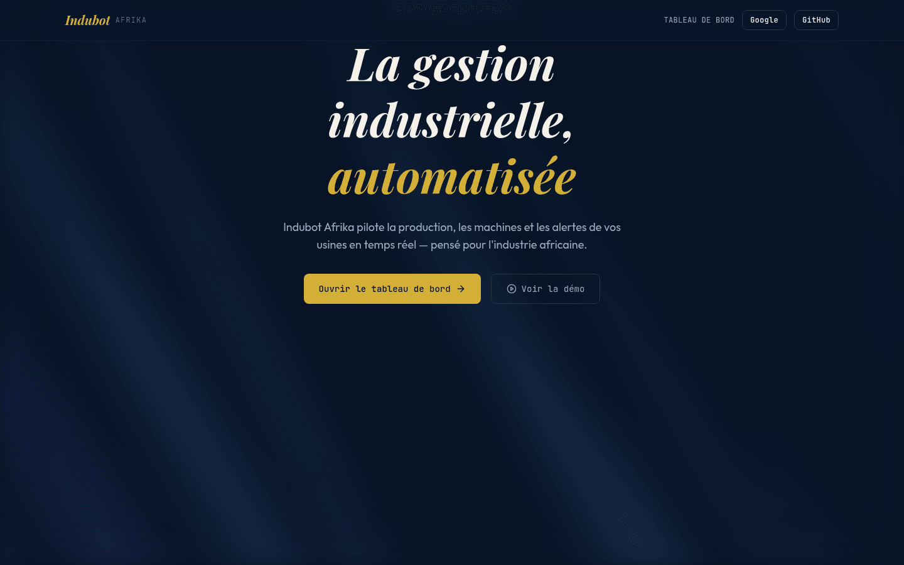
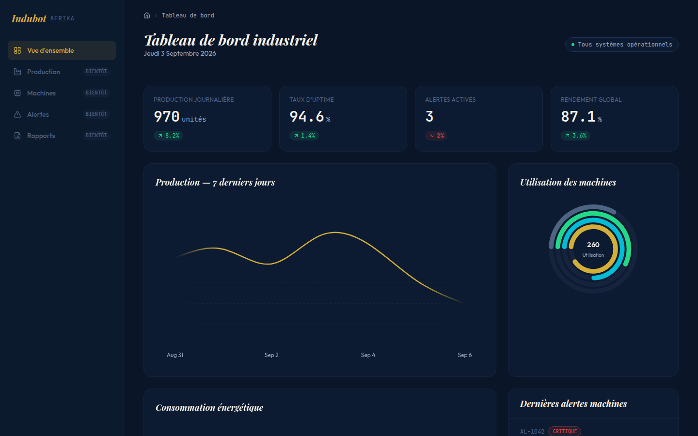

<p align="center"></p>

<div align="center">

# 🏭 Indubot Afrika

*Gestion industrielle en temps réel — production, machines, alertes et rapports*

[](https://nextjs.org)
[](https://react.dev)
[](https://www.typescriptlang.org)
[](https://airbnb.io/visx/)
[](.github/workflows/ci.yml)

**[🌐 Site en ligne](https://indubot-afrika.vercel.app)**

</div>

---

## À propos

Indubot Afrika est le logiciel de gestion d'industries de l'écosystème **Forge Afrika** : suivi de production, état des machines, alertes et rapports, pour des unités industrielles d'Afrique de l'Ouest.

Le dépôt contient aujourd'hui la **vitrine pré-lancement** et une **démonstration du tableau de bord** : la landing page (présentation du MVP, FAQ, contact) et le module « Vue d'ensemble » avec ses graphiques.

> **État actuel.** Les données du tableau de bord sont générées côté client pour la démonstration — il n'y a pas encore de connexion à un automate ou à une base de production. Quatre modules sur cinq sont affichés comme **à venir**.

---

## Aperçu

Captures générées depuis l'application réelle — voir `scripts/captures.mjs`.

### Vitrine



### Tableau de bord industriel

Production journalière, taux d'uptime, alertes actives et rendement global, avec courbe de production sur sept jours et anneau d'utilisation des machines.



---

## Modules

| Module | État |
|---|---|
| Vue d'ensemble | ✅ |
| Production | 🚧 à venir |
| Machines | 🚧 à venir |
| Alertes | 🚧 à venir |
| Rapports | 🚧 à venir |

Les modules à venir apparaissent dans la barre latérale, désactivés et marqués comme tels — plutôt que sous forme de boutons qui semblent cliquables mais ne font rien.

---

## Stack

```
Framework   : Next.js 16 (App Router) + React 19
Langage     : TypeScript 5, mode strict
Styles      : Tailwind CSS v4
Graphiques  : visx (@visx/shape, scale, axis, tooltip…)
Animations  : Framer Motion, @number-flow/react
Auth        : Better Auth (Google, GitHub)
Données     : Supabase
Analytics   : Google Analytics
```

---

## Démarrer

**Prérequis :** Node.js 22+

```bash
git clone https://github.com/dosteeve2-hash/indubot-afrika.git
cd indubot-afrika
npm ci
npm run dev
```

Ouvre [http://localhost:3000](http://localhost:3000). La vitrine et le tableau de bord de démonstration fonctionnent **sans configuration**.

### Variables d'environnement

Nécessaires uniquement pour l'authentification, la persistance et les statistiques :

```bash
cp .env.local.example .env.local
```

| Groupe | Variables |
|---|---|
| Better Auth | `BETTER_AUTH_SECRET`, `BETTER_AUTH_URL`, `NEXT_PUBLIC_BETTER_AUTH_URL` |
| Fournisseurs | `GOOGLE_CLIENT_ID`, `GOOGLE_CLIENT_SECRET`, `GITHUB_CLIENT_ID`, `GITHUB_CLIENT_SECRET` |
| Supabase | `NEXT_PUBLIC_SUPABASE_URL`, `NEXT_PUBLIC_SUPABASE_ANON_KEY` |
| Analytics | `NEXT_PUBLIC_GA_MEASUREMENT_ID` |

### Scripts

| Commande | Rôle |
|---|---|
| `npm run dev` | Serveur de développement |
| `npm run build` | Build de production |
| `npm run lint` | ESLint |

---

## Contact

Zone Industrielle de Kossodo, Ouagadougou, Burkina Faso · [contact@forge-afrika.com](mailto:contact@forge-afrika.com)

---

<div align="center">

**[Steve Donald Compaoré](https://steeve-portfolio-mocha.vercel.app)** · [docompaore2@gmail.com](mailto:docompaore2@gmail.com)

*FORGE Afrika*

</div>
